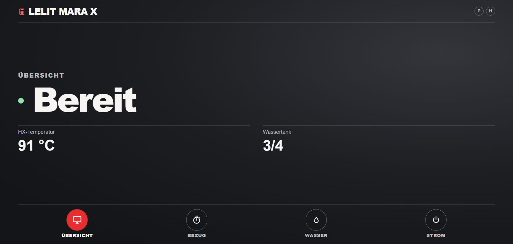

# Lelit Mara X auf dem Fire HD 10

Dieses Home-Assistant-Dashboard zeigt eine manuell bediente Lelit Mara X PL62X auf einem Fire HD 10. Ein Seeed Studio XIAO ESP32-C3 liefert die Maschinendaten über ESPHome. In den vier Ansichten **Übersicht**, **Bezug**, **Wasser** und **Strom** ist der Smartplug unter **Strom** der einzige Schalter.

## Installation über HACS

1. Mit installiertem HACS die [Mara-X-Display-Card in HACS öffnen](https://my.home-assistant.io/redirect/hacs_repository/?owner=DanielP-1337&repository=lelit-mara-x-firehd&category=plugin). Alternativ in HACS unter **⋮ → Benutzerdefinierte Repositories** die URL `https://github.com/DanielP-1337/lelit-mara-x-firehd` mit dem Typ **Dashboard** hinzufügen.
2. **Mara-X-Display-Card → Herunterladen** wählen und den Browser neu laden. Bei manuell in YAML verwalteten Dashboard-Ressourcen `/hacsfiles/lelit-mara-x-firehd/lelit-mara-x-firehd.js` als Ressource vom Typ `module` eintragen.
3. Beim Umstieg von der manuellen Installation den bisherigen Ressourceneintrag `/local/marax-firehd-card.js` (ggf. mit Versionsparameter) entfernen, sobald die HACS-Ressource eingetragen ist. Vorhandene Dashboards verwenden weiterhin `custom:marax-firehd-card`.

### Manuelle Installation

Die Datei `lelit-mara-x-firehd.js` aus dem [aktuellen Release](https://github.com/DanielP-1337/lelit-mara-x-firehd/releases/latest) als `www/marax-firehd-card.js` im Home-Assistant-Konfigurationsverzeichnis speichern. Unter **Einstellungen → Dashboards → Ressourcen** die URL `/local/marax-firehd-card.js` als JavaScript-Modul registrieren und den Browser neu laden.

## Tablet-Dashboard einrichten

HACS installiert die Display-Card. Das Beispiel-Dashboard und die Sensorvorlagen werden separat eingerichtet.

1. Das [Mara-X-Paket](homeassistant/packages/marax.yaml) im eingebundenen Paketverzeichnis ablegen. Die Entitätsnamen mit der eigenen Installation abgleichen, die Konfiguration prüfen und die Template-Entitäten neu laden.
2. Ein neues Dashboard mit dem URL-Pfad `firehd-mara-x` anlegen. Den Inhalt der [Dashboard-Konfiguration](homeassistant/dashboards/firehd-mara-x.yaml) in dessen Rohkonfigurationseditor übernehmen. Unter `entities` insbesondere den Smartplug und dessen Leistungssensor zuordnen.
3. Auf dem Tablet `/firehd-mara-x/tablet` öffnen. Mit `?disable_km` sind Kopfzeile und Seitenleiste für die Bearbeitung zugänglich.

Die [ESPHome-Konfiguration für den XIAO](esphome/mara-x.yaml) enthält die GPIO-Belegung, den Durchflussmesser und die Temperaturfühler der Anlage. In der lokalen ESPHome-Datei `secrets.yaml` die Werte für `wifi_ssid`, `wifi_password` und `marax_fallback_password` eintragen. Die sechs 1-Wire-Adressen aus dem ESPHome-Log als Hexwerte den Schlüsseln `marax_address_tank_air`, `marax_address_tank_upper`, `marax_address_tank_lower`, `marax_address_tank_bottom`, `marax_address_hot_water_spout` und `marax_address_steam_wand` zuordnen.

## Bezug und Durchfluss

Bei Pumpenstart öffnet sich **Bezug**. Spülstöße unter drei Sekunden führen direkt zur Übersicht zurück. Ein erkannter Espresso bleibt nach Pumpenstopp acht Sekunden sichtbar. Spülstöße, erkannter Heißwasserbezug und erkannter Dampf erhalten die Werte des letzten Espressos.

Die Karte rechnet den Wasserfluss von ml/min in ml/s um und glättet die Live-Anzeige über zwei Sekunden. Für einen abgeschlossenen Bezug teilt sie die gemessene Wassermenge durch die Laufzeit. 36 ml in 30 Sekunden ergeben 1,2 ml/s. Die Grenzen für die Farbanzeige stehen im Dashboard unter `flow_min_ml_s` und `flow_max_ml_s`.

## Lizenz

Die Mara-X-Display-Card und die mitgelieferten Konfigurationen stehen unter der [MIT-Lizenz](LICENSE). Das Tablet-Layout orientiert sich an der [Braumeister-Display-Card](https://github.com/DanielP-1337/braumeister-display-card).
